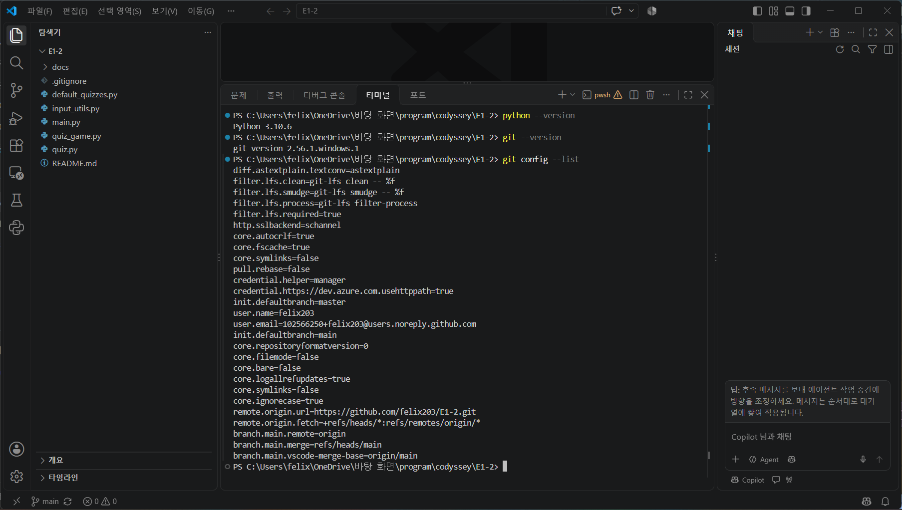
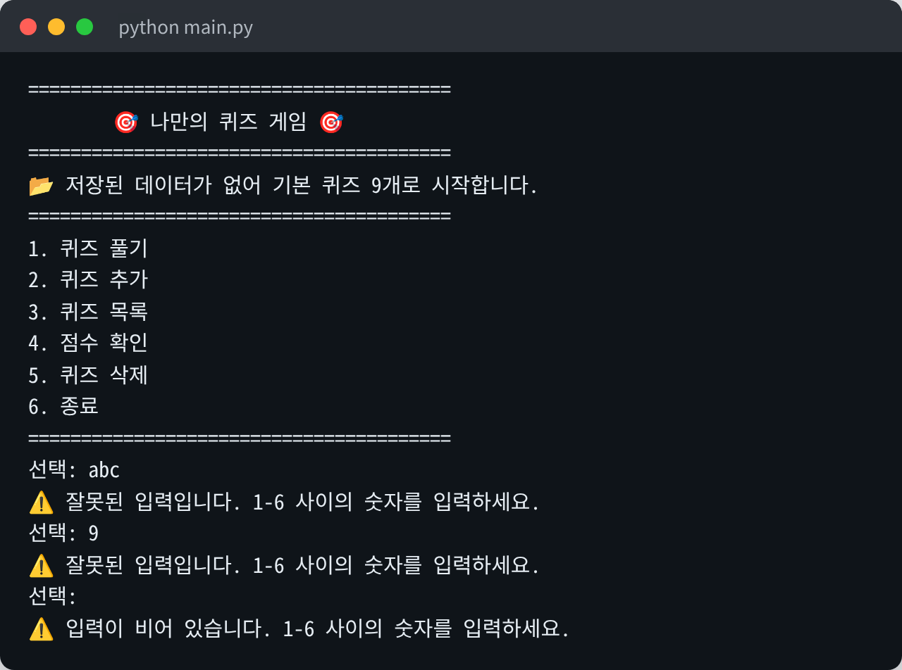
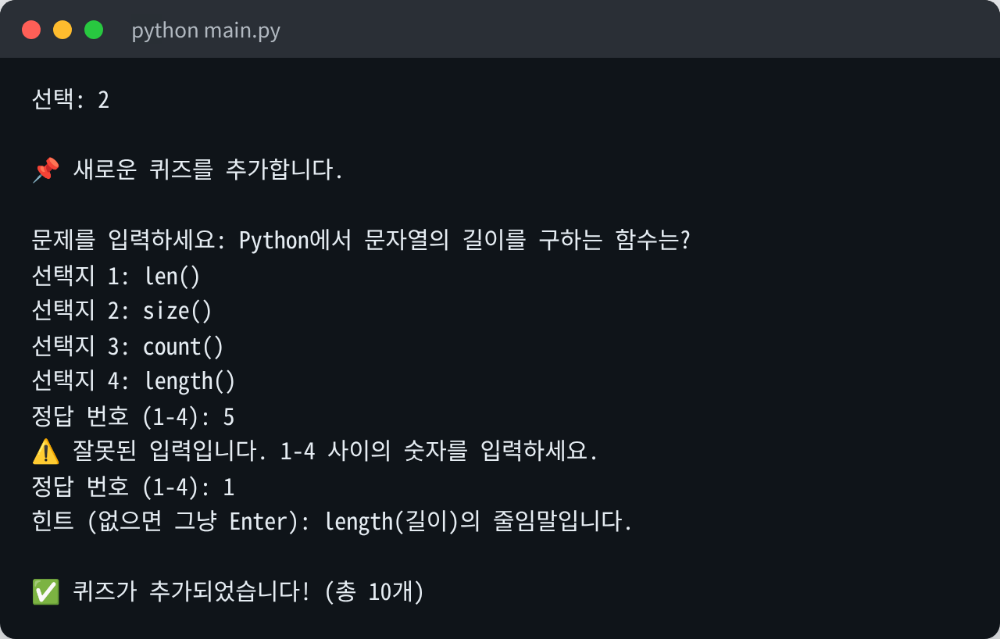
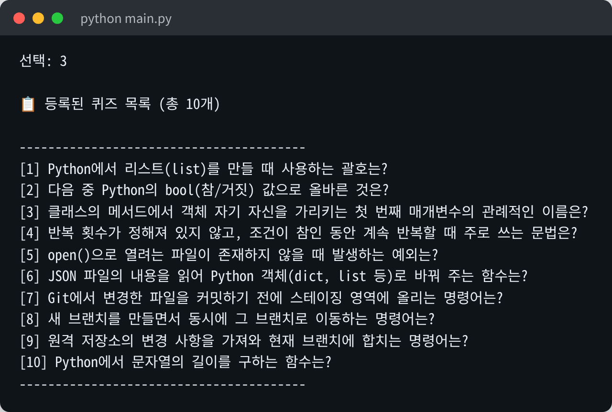
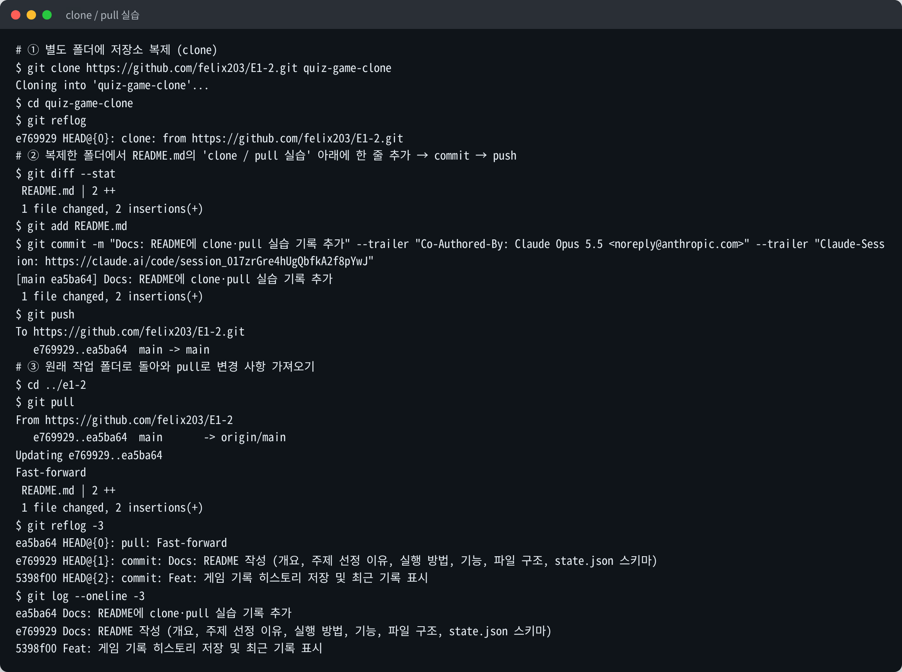

# 🎯 나만의 퀴즈 게임 (Python & Git 기초)

## 프로젝트 개요

터미널에서 동작하는 4지선다 퀴즈 게임입니다.
메뉴에서 번호를 골라 퀴즈를 풀고, 새 퀴즈를 추가하고, 목록과 최고 점수를 확인할 수 있습니다.
퀴즈와 점수는 `state.json` 파일에 저장되어 프로그램을 껐다 켜도 그대로 유지됩니다.

- 언어: Python 3.10 이상 (외부 라이브러리 없음, 표준 라이브러리만 사용)
- 구조: `Quiz`(문제 1개) / `QuizGame`(게임 전체) 2개 클래스로 역할 분리
- 버전 관리: Git 기능 단위 커밋, 브랜치 생성·병합, GitHub 공개 저장소

## 퀴즈 주제와 선정 이유

**주제: Python & Git 기초**

이번 미션에서 처음 배우는 Python 문법(자료형, 반복문, 클래스, 파일 입출력, 예외 처리)과
Git 명령어(add, checkout, pull 등)를 퀴즈로 만들었습니다.
직접 문제와 오답 선택지를 만들다 보면 헷갈리는 개념을 한 번 더 정리하게 되고,
완성한 게임으로 배운 내용을 다시 복습할 수 있어서 이 주제를 골랐습니다.

## 실행 방법

```bash
# 1. 저장소 복제
git clone https://github.com/felix203/E1-2.git
cd E1-2

# 2. Python 버전 확인 (3.10 이상)
python --version      # macOS/Linux에서는 python3 --version

# 3. 실행
python main.py        # macOS/Linux에서는 python3 main.py
```

처음 실행하면 `state.json`이 없으므로 기본 퀴즈 9개로 시작하고, 프로젝트 루트에 `state.json`이 자동으로 만들어집니다.

## 기능 목록

| 메뉴 | 기능 | 설명 |
| --- | --- | --- |
| 1 | 퀴즈 풀기 | 풀 문제 수를 고르면 랜덤 순서로 출제, 문제마다 정답/오답과 정답 번호를 알려 주고 마지막에 결과(점수) 표시 |
| 2 | 퀴즈 추가 | 문제, 선택지 4개, 정답 번호(1-4), 힌트(선택)를 입력받아 등록 후 바로 파일에 저장 |
| 3 | 퀴즈 목록 | 등록된 퀴즈의 문제 목록 출력 |
| 4 | 점수 확인 | 최고 점수와 최근 게임 기록 5개 출력 |
| 5 | 퀴즈 삭제 | 번호로 퀴즈를 골라 확인(y/n) 후 삭제, 파일에 반영 |
| 6 | 종료 | 데이터 저장 후 종료 |

### 점수 계산

- 100점 만점: `정답 점수 ÷ 푼 문제 수 × 100` (반올림)
- 정답 1개 = 1점, **힌트를 보고 맞히면 0.5점**
- 게임이 끝날 때마다 최고 점수와 비교해 더 높으면 갱신하고 저장합니다.
- 점수가 같으면 **더 많은 문제를 푼 기록**을 최고 기록으로 남깁니다. (1문제 100점이 9문제 100점보다 앞서지 않도록)

### 보너스 기능

- 랜덤 출제 (`random.sample`)
- 문제 수 선택
- 힌트 (`h` 입력, 사용 시 점수 차감)
- 퀴즈 삭제
- 점수 기록 히스토리 (날짜/시간, 푼 문제 수, 정답 수, 힌트 사용 수, 점수)

### 입력 / 예외 처리

| 상황 | 처리 |
| --- | --- |
| 앞뒤 공백 (` 1 `) | 공백 제거 후 처리 |
| 숫자가 아닌 입력 (`abc`) | 안내 메시지 후 다시 입력 |
| 범위 밖 숫자 (메뉴 `9`, 정답 `0`) | 안내 메시지 후 다시 입력 |
| 빈 입력 (그냥 Enter) | 안내 메시지 후 다시 입력 |
| Ctrl+C / 입력 스트림 종료(EOF) | 안내 메시지 출력, 데이터 저장 후 정상 종료 |
| `state.json` 없음 | 기본 퀴즈로 시작하고 새로 생성 |
| `state.json` 손상 | 안내 메시지 출력, 손상된 파일은 `state.json.bak`으로 백업 후 기본 퀴즈로 복구 |
| 일부 퀴즈만 형식 오류 | 해당 퀴즈만 건너뛰고 나머지는 불러옴 |
| 파일 저장 실패 | 안내 메시지 출력 후 프로그램은 계속 실행 |
| 콘솔 인코딩이 cp949인 환경 (Windows Git Bash 등) | 시작 시 입출력을 UTF-8로 맞춰 이모지·한글 출력 오류 방지 |

Ctrl+C를 누르면 아래처럼 안내하고 종료합니다. 입력이 끊긴 경우(EOF)에는 첫 줄이 `⚠️ 입력이 종료되어 프로그램을 안전하게 종료합니다.`로 바뀝니다.

```
⚠️ Ctrl+C 입력이 감지되어 프로그램을 안전하게 종료합니다.
💾 현재까지의 데이터를 저장했습니다.
```

종료 안내가 나오는 도중에 Ctrl+C를 한 번 더 누르면 `main.py`에서 다시 잡아 `프로그램을 종료합니다.`만 출력하고 끝납니다. 어느 경우에도 Traceback(오류 화면)은 나오지 않습니다.

### 저장 실패·파일 손상 시 대처

- **저장 실패** (폴더 권한 없음, 디스크 가득 참, 다른 프로그램이 파일을 사용 중 등): `⚠️ 데이터를 저장하지 못했습니다. (원인: ...)`를 출력하고 프로그램은 계속 실행합니다. 데이터는 메모리에 그대로 남아 있고, 다음 저장 시점(퀴즈 추가·삭제, 풀기 종료, 프로그램 종료)마다 다시 저장을 시도합니다. 같은 원인이면 곧바로 다시 실패하므로 그 자리에서 반복 재시도하지는 않습니다. 원인을 해결한 뒤 6번으로 종료하면 저장됩니다.
- **파일 손상** (JSON 문법 오류, 키가 없음, 구조가 다름): 손상된 파일을 `state.json.bak`으로 옮겨 두고 기본 퀴즈로 시작합니다. 예전 데이터를 되살리려면 다음과 같이 합니다.
  1. 프로그램을 종료합니다.
  2. `state.json.bak`을 에디터로 열어 깨진 부분(빠진 괄호·따옴표·쉼표)을 고칩니다.
  3. 고친 파일의 이름을 `state.json`으로 바꿉니다.
     - PowerShell: `Move-Item state.json.bak state.json -Force`
     - Git Bash / macOS: `mv state.json.bak state.json`
  4. 다시 실행해 `📂 저장된 데이터를 불러왔습니다`가 나오는지 확인합니다.
- **백업 안내가 나오지 않은 경우**: 손상 안내 아래에 `손상된 파일은 state.json.bak(으)로 백업해 두었습니다`가 없으면 백업(파일 이름 바꾸기)에 실패한 것입니다. 이때는 보통 같은 이유로 저장도 실패해(`⚠️ 데이터를 저장하지 못했습니다`가 함께 나옴) 원래 파일이 그대로 남아 있습니다. 프로그램을 끄고 `state.json`을 다른 이름으로 복사해 둔 뒤 위 2~4단계를 진행합니다.

## 파일 구조

```
.
├── main.py              # 실행 진입점 (콘솔 UTF-8 설정, QuizGame 생성 후 run)
├── quiz.py              # Quiz 클래스: 문제/선택지/정답/힌트, 출력·정답 확인·dict 변환
├── quiz_game.py         # QuizGame 클래스: 메뉴, 퀴즈 풀기/추가/목록/삭제, 점수, 저장/불러오기
├── default_quizzes.py   # 기본 퀴즈 9개 (Quiz 인스턴스로 생성)
├── input_utils.py       # 공통 입력 처리 함수 (공백 제거, 숫자/범위/빈 입력 검사)
├── state.json           # 실행 중 자동 생성되는 데이터 파일 (Git에는 올리지 않음)
├── .gitignore
├── README.md
└── docs/
    └── screenshots/     # 실행 화면 캡처
```

## 데이터 파일 설명 (`state.json`)

- **경로**: 프로젝트 루트의 `state.json` (`quiz_game.py`가 있는 폴더 기준이라 어느 위치에서 실행해도 같은 파일 사용)
- **인코딩**: UTF-8 (`ensure_ascii=False`로 한글을 그대로 저장)
- **역할**: 퀴즈 목록, 최고 점수, 게임 기록을 저장해 프로그램을 다시 실행해도 유지
- **저장 시점**: 퀴즈 추가·삭제 직후, 퀴즈 풀기 종료 후, 프로그램 종료 시
- **Git 관리**: 사용자마다 다른 플레이 데이터라 `.gitignore`에 포함 (없으면 첫 실행 때 자동 생성)

### 스키마

| 키 | 타입 | 설명 |
| --- | --- | --- |
| `quizzes` | list | 퀴즈 목록 |
| `quizzes[].question` | str | 문제 |
| `quizzes[].choices` | list[str] | 선택지 4개 |
| `quizzes[].answer` | int | 정답 번호 (1-4) |
| `quizzes[].hint` | str | 힌트 (없으면 빈 문자열) |
| `best_score` | int \| null | 최고 점수 (0-100), 아직 풀지 않았으면 `null` |
| `best_detail` | object \| null | 최고 점수를 받은 판의 `correct`(정답 수), `total`(문제 수), `hints_used`(힌트 수) |
| `history` | list | 모든 게임 기록 |
| `history[].played_at` | str | 플레이 일시 (`YYYY-MM-DD HH:MM:SS`) |
| `history[].total` / `correct` / `hints_used` / `score` | int | 푼 문제 수 / 정답 수 / 힌트 사용 수 / 점수 |

### 예시

```json
{
    "quizzes": [
        {
            "question": "Git에서 변경한 파일을 커밋하기 전에 스테이징 영역에 올리는 명령어는?",
            "choices": ["git commit", "git add", "git push", "git init"],
            "answer": 2,
            "hint": "커밋할 목록에 '추가'하는 단계입니다."
        }
    ],
    "best_score": 80,
    "best_detail": {"correct": 4, "total": 5, "hints_used": 0},
    "history": [
        {"played_at": "2026-11-11 14:05:12", "total": 5, "correct": 4, "hints_used": 0, "score": 80}
    ]
}
```

## 설계 설명

### 클래스와 모듈별 책임

| 클래스 / 모듈 | 책임 | 주요 메서드 |
| --- | --- | --- |
| `Quiz` (`quiz.py`) | 문제 1개의 데이터와 그 데이터를 다루는 동작 | `display()` 출력, `is_correct()` 정답 확인, `has_hint()`, `to_dict()` / `from_dict()` 저장 형식 변환 |
| `QuizGame` (`quiz_game.py`) | 게임 진행, 상태(퀴즈 목록·최고 점수·기록) 관리, 저장 | `run()`, `show_menu()`, `play_quiz()`, `add_quiz()`, `list_quizzes()`, `delete_quiz()`, `show_score()`, `load_state()`, `save_state()` |
| `input_utils.py` (함수 모음) | 사용자 입력 검증 | `parse_int()`, `ask_int()`, `ask_text()`, `ask_yes_no()` |
| `default_quizzes.py` | 기본 퀴즈 데이터 | `get_default_quizzes()` → `Quiz` 9개 |

### 클래스를 사용한 이유 (함수만 쓸 때와 비교)

- **캡슐화**: 문제·선택지·정답과, 이것을 다루는 동작(출력, 정답 확인, 저장 형식 변환)을 `Quiz` 하나에 묶었습니다. 퀴즈를 dict로만 다루면 여러 함수가 `quiz["answer"]` 같은 키를 직접 꺼내 써야 하고 키 오타는 실행 중에야 드러나지만, `quiz.is_correct(2)`처럼 메서드로 쓰면 규칙이 한 곳에 모입니다.
- **상태 관리**: 퀴즈 목록, 최고 점수, 게임 기록은 거의 모든 기능이 함께 쓰는 상태입니다. 함수만 쓰면 전역 변수로 두거나 모든 함수에 매개변수로 넘겨야 하는데, `QuizGame`의 속성(`self.quizzes`, `self.best_score`, `self.history`)으로 두면 메서드끼리 자연스럽게 공유하고, 무엇을 저장해야 하는지도 분명해집니다.
- **확장과 재사용**: 힌트 기능은 `Quiz`에 `hint` 속성과 `has_hint()`만 더해서 추가했습니다. 저장 파일 경로도 `QuizGame(state_path=...)`로 바꿔 넣을 수 있어, 테스트할 때 실제 데이터를 건드리지 않고 다른 파일을 쓸 수 있습니다.
- **단점**: 이 정도 크기는 함수만으로도 만들 수 있고, 클래스를 쓰면 `__init__`·`self` 같은 개념과 코드 양이 늘어납니다. 그래서 상태가 필요 없는 입력 검증은 클래스로 만들지 않고 `input_utils.py`의 함수로 두었습니다.

### 입력 검증과 저장(IO)을 나눈 기준

서로 다른 이유로 바뀌는 코드를 다른 곳에 두었습니다(단일 책임 원칙). 입력 규칙(허용 범위, 안내 문구)이 바뀌면 `input_utils.py`만, 저장 형식이 바뀌면 `QuizGame`의 저장·불러오기 메서드와 `Quiz.to_dict()` / `from_dict()`만 고치면 됩니다. 게임 진행 메서드(`play_quiz()` 등)는 두 경우 모두 그대로입니다.

### state.json 읽기·저장 흐름

- **읽기**: 파일이 있는지 확인 → `json.load()`로 읽기 → `apply_state()`에서 구조와 값 검증 → 검증을 **모두 통과한 뒤에** 속성에 한꺼번에 반영. 검증에 실패하면 손상된 파일을 `state.json.bak`으로 옮기고 기본 퀴즈로 복구합니다.
- **저장**: `state.json.tmp`에 먼저 쓴 뒤 `os.replace()`로 원래 파일과 바꿔치기합니다. 저장 도중 프로그램이 꺼져도 기존 `state.json`은 깨지지 않습니다.
- **저장 시점**: 퀴즈 추가·삭제 직후, 퀴즈 풀기가 끝난 뒤, 프로그램 종료(6번, Ctrl+C, EOF) 시.

### 저장 필드를 이렇게 나눈 이유

- `best_score`: 미션의 최소 스키마. 0~100점 정수입니다.
- `best_detail`: 점수만으로는 "몇 문제 중 몇 개"였는지 알 수 없어서 따로 저장합니다. 점수가 같을 때 더 많은 문제를 푼 기록을 우선하는 비교에도 씁니다.
- `history`: 보너스 과제(모든 게임 기록). 하나뿐인 최고 기록과 달리 계속 쌓이는 목록이라 별도 키로 분리했습니다.
- `hint`: 없을 수도 있는 값이라 빈 문자열을 기본값으로 두었습니다. 힌트 없이 저장된 예전 데이터도 그대로 읽힙니다.

### JSON을 선택한 이유와 한계

| 장점 | 한계 |
| --- | --- |
| 텍스트 파일이라 사람이 열어서 읽고 고칠 수 있음 | 저장할 때마다 **파일 전체를 다시 씀** → 데이터가 커질수록 저장이 느려짐 |
| Python의 dict / list와 그대로 대응 (`json.load` / `json.dump`) | 불러올 때 **전체를 메모리에 올림** → 수십만 건이면 시작이 느려지고 메모리 부담이 커짐 |
| 표준 라이브러리만으로 처리, UTF-8로 한글 그대로 저장 | 일부만 읽거나 고치는 기능이 없음 (검색·수정도 항상 전체를 읽고 씀) |
| 이 프로그램 규모(퀴즈 수십 개, 기록 수백 건)에서는 충분히 빠름 | 트랜잭션과 동시 쓰기 제어가 없음 (두 프로그램이 동시에 쓰면 한쪽 변경이 사라짐). 임시 파일 교체로는 "쓰다가 깨지는 것"만 막음 |
| | `history`는 플레이할 때마다 늘어나서 파일이 계속 커짐 |

데이터가 커지면 다음과 같이 바꾸는 것을 고려합니다.

- 퀴즈·기록이 수만 건 이상: 표준 라이브러리 `sqlite3`(SQLite 데이터베이스)로 옮겨 필요한 행만 읽고 쓰기
- 기록만 많아지는 경우: `history`를 한 줄에 기록 하나씩 쓰는 JSON Lines 파일로 분리해 **끝에 덧붙이기만** 하거나, 최근 N건만 보관하기

### 요구사항이 바뀔 때 수정할 곳

| 변경 내용 | 수정할 파일 · 메서드 / 상수 |
| --- | --- |
| 선택지 개수 (4개 → 5개) | `quiz.py`의 `Quiz.CHOICE_COUNT` (입력 범위와 검증은 이 값을 따라감). 기존 `state.json`의 4지선다 퀴즈는 형식 오류로 처리되므로 변환이 필요 |
| 퀴즈에 새 항목 추가 (예: 난이도) | `quiz.py`의 `__init__`, `display`, `to_dict`, `from_dict` / `quiz_game.py`의 `add_quiz` / README 스키마 |
| 점수 계산, 힌트 감점 비율 | `quiz_game.py`의 `HINT_CREDIT`, `calculate_score`, `play_quiz` |
| 최고 점수 비교 규칙 | `quiz_game.py`의 `update_best_score` |
| 출제 방식 (랜덤 끄기, 문제 수 고정) | `quiz_game.py`의 `play_quiz`(`random.sample`), `ask_question_count` |
| 메뉴 추가, 순서 변경 | `quiz_game.py`의 `MENU_ITEMS`, `handle_choice`, 새 메서드 |
| 입력 규칙, 안내 문구 | `input_utils.py`의 `parse_int`, `ask_text`, `ask_yes_no` |
| 저장 위치, 파일 형식 | `quiz_game.py`의 `STATE_PATH`, `load_state`, `apply_state`, `save_state`, `to_state_dict` |
| 기본 퀴즈 주제, 개수 | `default_quizzes.py`의 `get_default_quizzes` |
| 기록 표시 개수 | `quiz_game.py`의 `RECENT_HISTORY_COUNT`, `show_score` |

## 개발 환경

| 항목 | 내용 |
| --- | --- |
| Python | 3.10 이상 (개발 PC: 3.10.6 / 실행 확인: 3.8 · 3.10 · 3.13) |
| Git | 2.56.1 (Git for Windows) |
| 라이브러리 | 표준 라이브러리만 사용 (`json`, `os`, `random`, `datetime`, `pathlib`, `sys`) |
| OS | Windows · macOS · Linux 터미널 (Windows Git Bash처럼 출력 인코딩이 cp949인 환경도 지원) |
| 에디터 | VSCode |



## 실행 화면

### 메뉴와 잘못된 입력 처리


### 퀴즈 풀기 (힌트 사용, 정답/오답, 결과)


### 퀴즈 추가


### 퀴즈 목록


### 점수 확인 (최고 점수, 최근 기록)


### 다시 실행했을 때 데이터 유지


## Git 작업 기록

- 기능 단위로 커밋 (`Feat:` 기능 추가, `Refactor:` 구조 정리, `Docs:` 문서)
- 퀴즈 풀기 기능은 `feature/play-quiz` 브랜치에서 개발한 뒤 `main`에 병합 (`git merge --no-ff`)
- 커밋 이력 확인: `git log --oneline --graph`


### clone / pull 실습

1. 저장소를 다른 폴더(`quiz-game-clone`)에 `git clone`
2. 복제한 폴더에서 README에 한 줄 추가 → `commit` → `push`
3. 원래 작업 폴더에서 `git pull`로 변경 사항을 가져와 반영 확인

- 실습 완료: 이 줄은 복제한 폴더(`quiz-game-clone`)에서 추가해 push했고, 원래 작업 폴더에서 `git pull`로 받았습니다.



