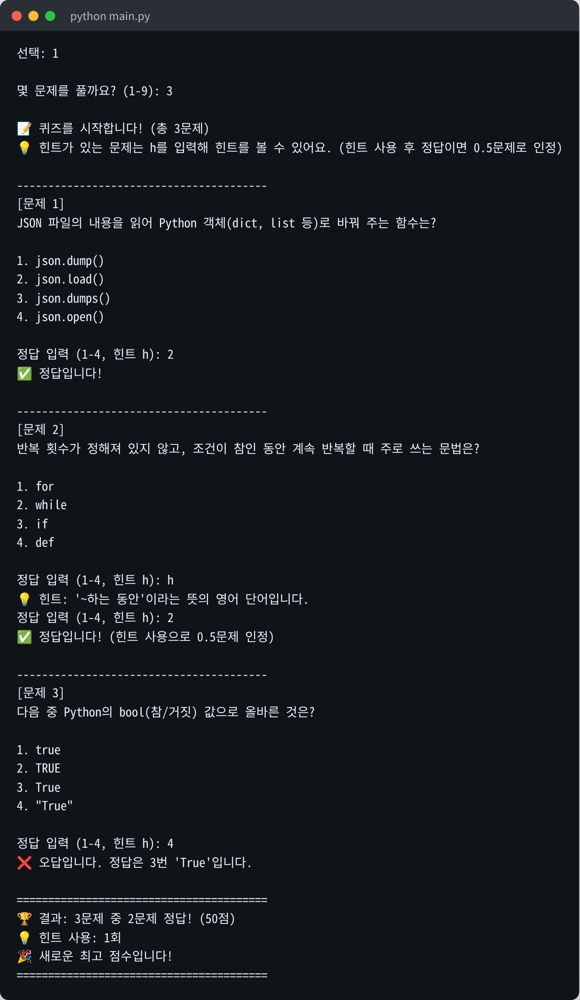
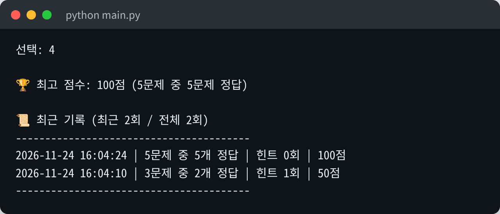
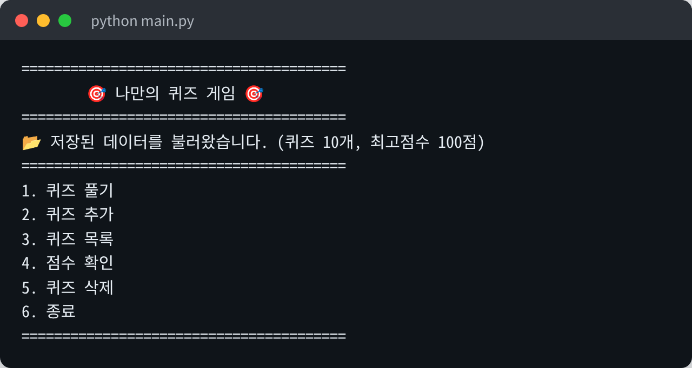
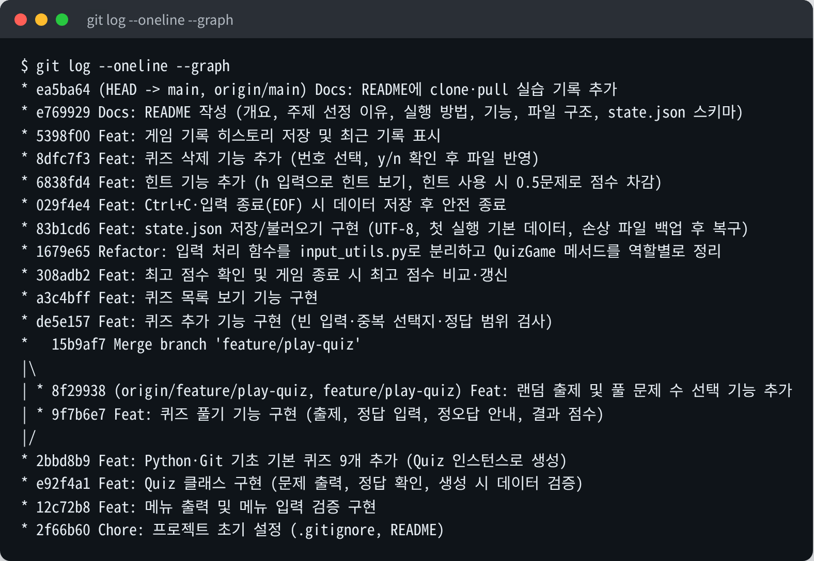

# 🎯 나만의 퀴즈 게임 (Python & Git 기초)

## 프로젝트 개요

터미널에서 동작하는 4지선다 퀴즈 게임입니다.
메뉴에서 번호를 골라 퀴즈를 풀고, 새 퀴즈를 추가하고, 목록과 최고 점수를 확인할 수 있습니다.
퀴즈와 점수는 `state.json` 파일에 저장되어 프로그램을 껐다 켜도 그대로 유지됩니다.

- 언어: Python 3.10 이상 (외부 라이브러리 없음, 표준 라이브러리만 사용)
- 구조: `Quiz`(문제 1개) / `QuizGame`(게임 전체) 2개 클래스로 역할 분리
- 버전 관리: Git 기능 단위 커밋, 브랜치 생성·병합, GitHub 공개 저장소

## 퀴즈 주제와 선정 이유

**주제: Python & Git 기초**

이번 미션에서 처음 배우는 Python 문법(자료형, 반복문, 클래스, 파일 입출력, 예외 처리)과
Git 명령어(add, checkout, pull 등)를 퀴즈로 만들었습니다.
직접 문제와 오답 선택지를 만들다 보면 헷갈리는 개념을 한 번 더 정리하게 되고,
완성한 게임으로 배운 내용을 다시 복습할 수 있어서 이 주제를 골랐습니다.

## 실행 방법

```bash
# 1. 저장소 복제
git clone https://github.com/felix203/E1-2.git
cd E1-2

# 2. Python 버전 확인 (3.10 이상)
python --version      # macOS/Linux에서는 python3 --version

# 3. 실행
python main.py        # macOS/Linux에서는 python3 main.py
```

처음 실행하면 `state.json`이 없으므로 기본 퀴즈 9개로 시작하고, 프로젝트 루트에 `state.json`이 자동으로 만들어집니다.

## 기능 목록

| 메뉴 | 기능 | 설명 |
| --- | --- | --- |
| 1 | 퀴즈 풀기 | 풀 문제 수를 고르면 랜덤 순서로 출제, 문제마다 정답/오답과 정답 번호를 알려 주고 마지막에 결과(점수) 표시 |
| 2 | 퀴즈 추가 | 문제, 선택지 4개, 정답 번호(1-4), 힌트(선택)를 입력받아 등록 후 바로 파일에 저장 |
| 3 | 퀴즈 목록 | 등록된 퀴즈의 문제 목록 출력 |
| 4 | 점수 확인 | 최고 점수와 최근 게임 기록 5개 출력 |
| 5 | 퀴즈 삭제 | 번호로 퀴즈를 골라 확인(y/n) 후 삭제, 파일에 반영 |
| 6 | 종료 | 데이터 저장 후 종료 |

### 점수 계산

- 100점 만점: `정답 점수 ÷ 푼 문제 수 × 100` (반올림)
- 정답 1개 = 1점, **힌트를 보고 맞히면 0.5점**
- 게임이 끝날 때마다 최고 점수와 비교해 더 높으면 갱신하고 저장합니다.
- 점수가 같으면 **더 많은 문제를 푼 기록**을 최고 기록으로 남깁니다. (1문제 100점이 9문제 100점보다 앞서지 않도록)

### 보너스 기능

- 랜덤 출제 (`random.sample`)
- 문제 수 선택
- 힌트 (`h` 입력, 사용 시 점수 차감)
- 퀴즈 삭제
- 점수 기록 히스토리 (날짜/시간, 푼 문제 수, 정답 수, 힌트 사용 수, 점수)

### 입력 / 예외 처리

| 상황 | 처리 |
| --- | --- |
| 앞뒤 공백 (` 1 `) | 공백 제거 후 처리 |
| 숫자가 아닌 입력 (`abc`) | 안내 메시지 후 다시 입력 |
| 범위 밖 숫자 (메뉴 `9`, 정답 `0`) | 안내 메시지 후 다시 입력 |
| 빈 입력 (그냥 Enter) | 안내 메시지 후 다시 입력 |
| Ctrl+C / 입력 스트림 종료(EOF) | 안내 메시지 출력, 데이터 저장 후 정상 종료 |
| `state.json` 없음 | 기본 퀴즈로 시작하고 새로 생성 |
| `state.json` 손상 | 안내 메시지 출력, 손상된 파일은 `state.json.bak`으로 백업 후 기본 퀴즈로 복구 |
| 일부 퀴즈만 형식 오류 | 해당 퀴즈만 건너뛰고 나머지는 불러옴 |
| 파일 저장 실패 | 안내 메시지 출력 후 프로그램은 계속 실행 |
| 콘솔 인코딩이 cp949인 환경 (Windows Git Bash 등) | 시작 시 입출력을 UTF-8로 맞춰 이모지·한글 출력 오류 방지 |

## 파일 구조

```
.
├── main.py              # 실행 진입점 (콘솔 UTF-8 설정, QuizGame 생성 후 run)
├── quiz.py              # Quiz 클래스: 문제/선택지/정답/힌트, 출력·정답 확인·dict 변환
├── quiz_game.py         # QuizGame 클래스: 메뉴, 퀴즈 풀기/추가/목록/삭제, 점수, 저장/불러오기
├── default_quizzes.py   # 기본 퀴즈 9개 (Quiz 인스턴스로 생성)
├── input_utils.py       # 공통 입력 처리 함수 (공백 제거, 숫자/범위/빈 입력 검사)
├── state.json           # 실행 중 자동 생성되는 데이터 파일 (Git에는 올리지 않음)
├── .gitignore
├── README.md
└── docs/
    └── screenshots/     # 실행 화면 캡처
```

## 데이터 파일 설명 (`state.json`)

- **경로**: 프로젝트 루트의 `state.json` (`quiz_game.py`가 있는 폴더 기준이라 어느 위치에서 실행해도 같은 파일 사용)
- **인코딩**: UTF-8 (`ensure_ascii=False`로 한글을 그대로 저장)
- **역할**: 퀴즈 목록, 최고 점수, 게임 기록을 저장해 프로그램을 다시 실행해도 유지
- **저장 시점**: 퀴즈 추가·삭제 직후, 퀴즈 풀기 종료 후, 프로그램 종료 시
- **Git 관리**: 사용자마다 다른 플레이 데이터라 `.gitignore`에 포함 (없으면 첫 실행 때 자동 생성)

### 스키마

| 키 | 타입 | 설명 |
| --- | --- | --- |
| `quizzes` | list | 퀴즈 목록 |
| `quizzes[].question` | str | 문제 |
| `quizzes[].choices` | list[str] | 선택지 4개 |
| `quizzes[].answer` | int | 정답 번호 (1-4) |
| `quizzes[].hint` | str | 힌트 (없으면 빈 문자열) |
| `best_score` | int \| null | 최고 점수 (0-100), 아직 풀지 않았으면 `null` |
| `best_detail` | object \| null | 최고 점수를 받은 판의 `correct`(정답 수), `total`(문제 수), `hints_used`(힌트 수) |
| `history` | list | 모든 게임 기록 |
| `history[].played_at` | str | 플레이 일시 (`YYYY-MM-DD HH:MM:SS`) |
| `history[].total` / `correct` / `hints_used` / `score` | int | 푼 문제 수 / 정답 수 / 힌트 사용 수 / 점수 |

### 예시

```json
{
    "quizzes": [
        {
            "question": "Git에서 변경한 파일을 커밋하기 전에 스테이징 영역에 올리는 명령어는?",
            "choices": ["git commit", "git add", "git push", "git init"],
            "answer": 2,
            "hint": "커밋할 목록에 '추가'하는 단계입니다."
        }
    ],
    "best_score": 80,
    "best_detail": {"correct": 4, "total": 5, "hints_used": 0},
    "history": [
        {"played_at": "2026-11-11 14:05:12", "total": 5, "correct": 4, "hints_used": 0, "score": 80}
    ]
}
```

## 개발 환경

| 항목 | 내용 |
| --- | --- |
| Python | 3.10 이상 (3.8 · 3.10 · 3.13에서 실행 확인) |
| 라이브러리 | 표준 라이브러리만 사용 (`json`, `os`, `random`, `datetime`, `pathlib`, `sys`) |
| OS | Windows · macOS · Linux 터미널 (Windows Git Bash처럼 출력 인코딩이 cp949인 환경도 지원) |
| 에디터 | VSCode |

## 실행 화면

### 메뉴와 잘못된 입력 처리


### 퀴즈 풀기 (힌트 사용, 정답/오답, 결과)


### 퀴즈 추가


### 퀴즈 목록


### 점수 확인 (최고 점수, 최근 기록)


### 다시 실행했을 때 데이터 유지


## Git 작업 기록

- 기능 단위로 커밋 (`Feat:` 기능 추가, `Refactor:` 구조 정리, `Docs:` 문서)
- 퀴즈 풀기 기능은 `feature/play-quiz` 브랜치에서 개발한 뒤 `main`에 병합 (`git merge --no-ff`)
- 커밋 이력 확인: `git log --oneline --graph`



### clone / pull 실습

1. 저장소를 다른 폴더(`quiz-game-clone`)에 `git clone`
2. 복제한 폴더에서 README에 한 줄 추가 → `commit` → `push`
3. 원래 작업 폴더에서 `git pull`로 변경 사항을 가져와 반영 확인

- 실습 완료: 이 줄은 복제한 폴더(`quiz-game-clone`)에서 추가해 push했고, 원래 작업 폴더에서 `git pull`로 받았습니다.


